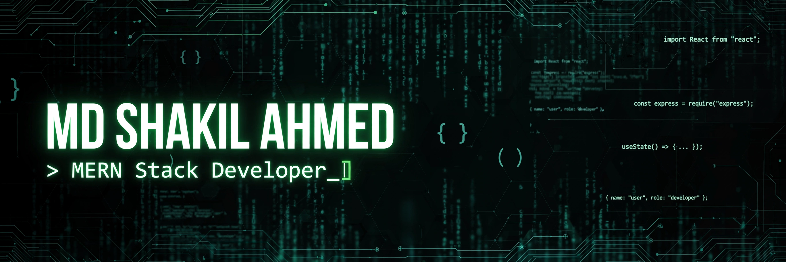

<h1 align="center">
  
</h1>

<p align="center">
  
  <a href="https://www.linkedin.com/in/shakilcreativework"></a>
  <a href="https://shakilcreativework-portfolio.vercel.app"></a>
  
</p>

---

### 👨‍💻 About Me

```javascript
const shakil = {
  role: "MERN Stack Developer",
  location: "Bangladesh 🇧🇩",
  stack: ["React", "Next.js", "Node.js", "Express", "MongoDB"],
  passions: ["Clean UI", "REST APIs", "AI Integrations", "Pixel Art 🎨"],
  currentlyLearning: "Advanced Next.js patterns & System Design",
  funFact: "I design thousands of pixel-art assets on Adobe Stock!"
};
```

- 🔭 Currently building full-stack web apps with the **MERN stack**
- 🌱 Exploring **Next.js 15**, server actions & AI-powered features
- 🎨 Also a **microstock contributor** — thousands of pixel-art assets on Adobe Stock
- 💼 Open to **internships & junior developer roles** — [let's connect!](https://www.linkedin.com/in/shakilcreativework)
- 📫 Portfolio: **[shakilcreativework-portfolio.vercel.app](https://shakilcreativework-portfolio.vercel.app)**

---

### 🛠️ Tech Stack

**Frontend**


**Backend & Database**


**Integrations & Tools**


---

### 🚀 Featured Projects

| Project | Description | Stack |
|---------|-------------|-------|
| 🍽️ **FlavorAI** | AI-powered recipe discovery with generator & cooking assistant | Next.js, Groq AI, MongoDB |
| 🎪 **Venuo** | Event booking platform with organizer dashboard & ticket sales | Next.js, Better Auth, Paddle |
| 🎨 **Creativedesign** | Premium digital design marketplace (SaaS) | Next.js, Paddle, Cloudinary |
| 📚 **Digital Life Lessons** | Content & subscription platform for life lessons | Next.js, Stripe, MongoDB |
| 🛒 **SunCart** | Summer essentials e-commerce store | Next.js, React, Tailwind |

👉 Explore them live on my **[portfolio](https://shakilcreativework-portfolio.vercel.app)**

---

### 📊 GitHub Stats

<p align="center">
  
  
</p>
<p align="center">
  
</p>

---

### 🎨 Beyond Code — Pixel Art

I'm also a **microstock contributor** crafting thousands of pixel-art assets:

<p>
  <a href="https://stock.adobe.com/contributor/211528330/shakilcreativework">
    
  </a>
  
</p>

---

### 🤝 Let's Connect

<p>
  <a href="https://www.linkedin.com/in/shakilcreativework"></a>
  <a href="https://shakilcreativework-portfolio.vercel.app"></a>
</p>

---

<p align="center">
  
</p>

<p align="center"><i>💚 Thanks for visiting — let's build something great together!</i></p>
